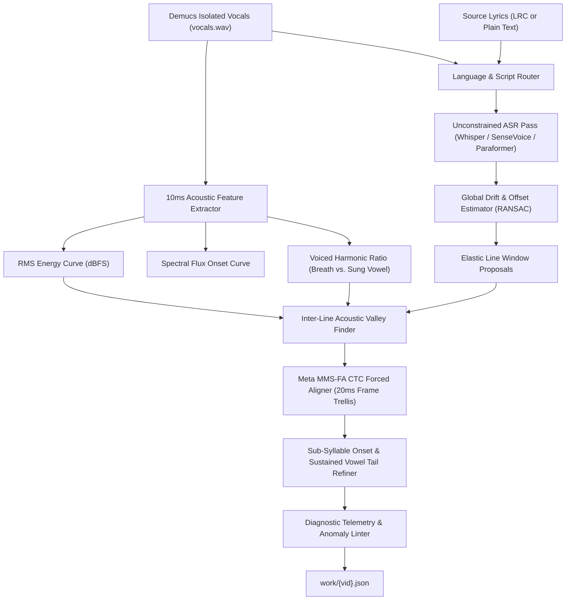

# Phase 7: Acoustic Alignment Architecture & Diagnostic Inspector Guide

## 1. Executive Summary & Core Philosophy

Our analysis of `mEB7-q0W1sE` exposed two fundamental weaknesses in traditional karaoke alignment pipelines:
1. **Over-trusting External LRC Timestamps:** Crowdsourced LRC files (NetEase, LRCLIB) frequently place line timestamps on breath intakes (~500ms early) or cut off sustained final notes (~1.5–2.5s early) before the next line actually begins. Treating `[start_i, start_{i+1}]` as a rigid wall forces the aligner to truncate held vowels and stuff the next line's opening words into the previous line's sustained tail.
2. **Opaque Alignment Decisions:** When a line aligns poorly, the JSON currently only stores the final `[start, end]` output. Without visibility into *what* the LRC originally claimed, *what* the ASR/Forced Aligner heard, *where* the vocal energy islands were detected, and *which* fallback path was taken, debugging is guesswork.

### Architectural Shift
1. **Treat LRC Timestamps as Soft Elastic Priors, Never Hard Walls:** Acoustic reality (isolated vocal stem energy, harmonic sustained vowels, and breath troughs) always overrides nominal LRC timestamps.
2. **Multi-Stage Acoustic Alignment (ASR + CTC Forced Alignment + Energy Valley Snapping):** Combine unconstrained ASR (for language/lyric verification) with **Meta MMS-FA (`torchaudio.pipelines.MMS_FA`)** forced alignment (for 20ms frame-accurate character/phoneme emission tracking) and 10ms RMS/spectral-flux boundary refinement.
3. **First-Class Provenance & Telemetry Schema:** After purging legacy files from `work/`, every generated file adheres to a unified v2 schema that records line-by-line and token-by-token alignment telemetry.
4. **Dedicated Pop-Out Alignment Diagnostics Inspector (`?view=diagnostics`):** A companion window/drawer—modeled after our Detached Video Monitor—that displays line-by-line provenance, multi-track timing comparisons (Nominal LRC vs. ASR vs. Forced Aligner vs. Vocal Energy), anomaly flags, and a **"Copy Line Debug Bundle"** button for rapid feedback loops.

---

## 2. Clean Workspace & Unified File Schemas (`work/` Directory)

When the `work/` directory is purged and fresh projects are ingested, only clean, structured artifacts are written:

| File Pattern | Purpose |
| :--- | :--- |
| `work/{vid}.wav` | Full original audio mix |
| `work/htdemucs/{vid}/vocals.wav` | Demucs isolated vocal stem (ground truth for energy & forced alignment) |
| `work/{vid}.meta.json` | Project metadata, visualizer config, background media, detected language & ASR engine |
| `work/{vid}.lrc` | Canonical source lyrics (if synced LRC was selected) |
| `work/{vid}.asr.{engine}.json` | Cached raw ASR output (`whisper`, `sensevoice`, `paraformer`, `mms_fa`) |
| `work/{vid}.json` | **Unified v2 Project Alignment & Diagnostics JSON** (detailed below) |

### 2.1 Upgraded `work/{vid}.json` Schema (Backwards-Compatible)

Each line and token in `{vid}.json` retains its existing fields (`start`, `end`, `is_backing`, `tokens`) while adding rich `_diag` telemetry blocks:

```json
[
  {
    "start": 9920,
    "end": 16690,
    "is_backing": false,
    "diag": {
      "line_idx": 0,
      "lrc_nominal_start": 9470,
      "lrc_nominal_end": 14910,
      "shift_from_lrc_start_ms": 450,
      "shift_from_lrc_end_ms": 1780,
      "alignment_method": "mms_fa_ctc",
      "phonetic_match_score": 94.2,
      "mean_ctc_score": 0.78,
      "mean_rms_db": -16.4,
      "lead_in_breath_trimmed_ms": 450,
      "tail_sustain_extended_ms": 1780,
      "voiced_islands": [
        [9920, 12680],
        [12710, 16690]
      ],
      "asr_heard_text": "i've held a lantern with an unrelenting flame",
      "asr_raw_tokens": [
        { "text": "i've", "start": 9930, "end": 10640 },
        { "text": "held", "start": 10660, "end": 11100 }
      ],
      "flags": [
        {
          "code": "TAIL_EXTENDED_PAST_NEXT_LRC",
          "severity": "info",
          "detail": "Sustained vocal energy (-14.2 dBFS) held 1780ms past next line's nominal LRC timestamp (14910ms)"
        },
        {
          "code": "LEADING_BREATH_SKIPPED",
          "severity": "info",
          "detail": "Skipped 450ms of low-energy breath/silence [9470..9920ms] (-34.8 dBFS)"
        }
      ]
    },
    "tokens": [
      {
        "text": "I've",
        "start": 9920,
        "end": 10650,
        "space": true,
        "pinyin": "I've",
        "en": "I've",
        "comment": "",
        "diag": {
          "source": "mms_fa",
          "ctc_score": 0.81,
          "rms_db": -15.2,
          "onset_strength": 1.42,
          "sustain_extended_ms": 0,
          "flags": []
        }
      }
    ]
  }
]
```

---

## 3. Next-Generation Acoustic Alignment Engine (`core/aligner.py` & `core/asr.py`)



### 3.1 Smart Language Auto-Detection (Fixing the Engine Mismatch)
Currently, `resolve_asr_engine()` defaults to `paraformer` (Mandarin) whenever the language isn't explicitly in the video title.
* **Fix:** Before running full transcription, inspect:
  1. Target lyrics script distribution (if lyrics are provided or cached).
  2. Or run a 15-second vocal probe through Whisper/SenseVoice language identification (`info.language`).
* Route English/Japanese/Korean/European songs to `whisper` (`large-v3-turbo`) + `mms_fa`, and Mandarin/Cantonese songs to `paraformer` + `mms_fa`.

### 3.2 De-Trusting LRC Timestamps: 4 Key Mechanisms

#### 1. Global & Piecewise Linear Drift Correction (RANSAC)
LRC files often have a constant offset (e.g., radio edit vs. MV intro) or linear drift.
* Match high-confidence ASR phrases against LRC lines across the whole song.
* Fit a robust piecewise linear offset model $\Delta t(t)$ using RANSAC so outlier lines don't skew the curve.
* Pre-shift all LRC nominal timestamps by $\Delta t(t)$ before local windowing.

#### 2. Elastic Inter-Line Boundary Negotiation (Sustain vs. Breath Separation)
Never slice a line at `next_lrc_start` if the singer is still holding a note!
* Given nominal boundary $B_{\text{nom}} = \text{lrc}[i+1].\text{start}$, search the window $[B_{\text{nom}} - 1200\text{ms}, B_{\text{nom}} + 2800\text{ms}]$.
* Compute an **Acoustic Boundary Cost Function** for every candidate timestamp $t$:
  $$\text{Cost}(t) = w_{\text{energy}} \cdot \text{RMS}_{\text{dB}}(t) + w_{\text{harmonic}} \cdot \text{Harmonicity}(t) - w_{\text{onset}} \cdot \text{OnsetPeak}(t + \epsilon) + w_{\text{prior}} \cdot \left(\frac{t - B_{\text{nom}}}{2000}\right)^2$$
* This naturally slides the boundary past sustained vowels (`"unrelenting flame..."`) and snaps directly into the breath trough (`16,690ms–16,960ms`) immediately preceding the consonant onset of the next phrase (`"To light..."`).

#### 3. Leading Breath & Pre-Phonatory Noise Rejection
Singers frequently take an audible breath 300–600ms before singing the first word of a line (as seen at `9,470ms` before `"I've"` at `9,927ms`).
* Breaths have moderate broadband RMS energy (`-35` to `-25 dBFS`) but **high spectral flatness / zero-crossing rate** and **low harmonic pitch confidence** compared to sung vowels.
* Adding a `spectral_flatness` / `voiced_flag` array (via `librosa.feature.spectral_flatness` or `pyin` voicing) to `VocalAnalyzer` lets us distinguish unvoiced breath intakes from voiced singing onsets, automatically trimming leading breaths even when the LRC timestamp starts on the inhale.

#### 4. Forced Alignment via Meta MMS-FA (`torchaudio.pipelines.MMS_FA`) + Blank-Frame Vowel Extension
Even when ASR mishears a sung or slurred word (e.g., hearing `"thes forward"` instead of `"thorns for the"`), **Forced Alignment** knows the target characters a priori and aligns the acoustic emission matrix directly to the lyric characters.
* **Handling Sung Melisma / Sustained Vowels in CTC:**
  Standard CTC forced aligners place the character token on the initial 20–60ms consonant/vowel attack and assign the remaining 1,500ms of held vowel to the `<blank>` token.
* **Our Solution (Acoustic Vowel Tail Extension):**
  After MMS-FA anchors the exact start frame of each word/syllable:
  * A token's start is locked to its MMS-FA consonant/vowel attack (snapped to the nearest 10ms spectral onset peak).
  * Its end is extended forward through any subsequent `<blank>` frames for as long as the vocal RMS remains above the local sustain threshold (`> -34 dBFS`) and before the next token's attack begins.

---

## 4. Ordered Diagnostic Hierarchy: What to Look At & In What Order

To make debugging systematic rather than overwhelming, both the automated pipeline and the new UI Inspector evaluate alignment health in **5 ordered tiers**:

| Order | Diagnostic Tier | What It Checks | Visual / Telemetry Signal |
| :---: | :--- | :--- | :--- |
| **Tier 1** | **Global & Language Sanity** | Did we use the right ASR engine for the song's language? Is there a global intro offset between LRC and vocals? | Header banner showing Engine, Detected Lang, Global Offset (e.g. `+420ms`), and Overall Alignment Confidence %. |
| **Tier 2** | **Line Boundary Integrity** | Did a line get cut off mid-note (`ERR_CUTOFF_ACTIVE_VOCAL`), or start on an inhale (`WARN_LEADING_BREATH`), or bleed into the next line? | Red/Amber boundary markers on the line card; shows `LRC Nominal` vs `Acoustic Actual` shift in ms. |
| **Tier 3** | **Alignment Method & Fallback** | How was this line aligned? (`MMS-FA High Conf` > `ASR Anchored` > `Island Weighted` > `Uniform Fallback`). | Color-coded badge per line (`🟢 CTC Forced`, `🔵 ASR Match`, `🟡 Energy Islands`, `🔴 Uniform Fallback`). |
| **Tier 4** | **Syllable & Word Acoustics** | Are individual tokens sitting in silence (`WARN_SILENCE_GHOST`), compressed into `<60ms` micro-syllables, or slurred/flubbed (`LOW_CTC_SCORE`)? | Per-token confidence heatmap + dBFS & CTC score readout on hover/selection. |
| **Tier 5** | **Human Review & Ground-Truth Capture** | Your token comments (`[C]`) and manual timing drags. | Filterable list of commented/flagged lines + 1-click export of a structured JSON debug snippet to paste into chat. |

---

## 5. UI Design: The Alignment Diagnostics Inspector (`🔬 Diagnostics`)

Just like the **📺 Pop-Out Video Monitor**, we will add a **🔬 Alignment Diagnostics** button in the Header Bar / Stage bar that can be opened either as a **split-pane drawer** or a **detached companion window (`?view=diagnostics&vid=...`)** synced in real time via `BroadcastChannel`.

### 5.1 Key Features of the Diagnostics Window

1. **Triage Filter & Sort Bar (Top):**
   * Sort lines by: **Timeline Order** or **Worst Confidence First (Triage Mode)**.
   * Filter pills: `All (43)` | `🔴 Flagged Issues (6)` | `🟡 Large LRC Drift >1s (8)` | `💬 Has My Comments (2)` | `🔴 Uniform Fallbacks (1)`.
2. **Line-by-Line Multi-Track Comparison Card:**
   For the currently active/selected line, renders a compact, stacked 4-lane mini-timeline (spanning `line.start - 1000ms` to `line.end + 1500ms`):
   * **Lane 1: Vocal Energy & Breath Curve:** 10ms RMS dBFS waveform shaded green for voiced singing, gray for unvoiced breath, dark for silence.
   * **Lane 2: Original LRC Window:** Shows where the raw `.lrc` file *wanted* the line to start and end (making early breath starts or premature cutoffs immediately obvious).
   * **Lane 3: Raw ASR / What the Model Heard:** Shows the exact words & timestamps transcribed by Whisper/SenseVoice/Paraformer (so you can see if the singer slurred or flubbed a word).
   * **Lane 4: Final Aligned Tokens:** Color-coded by `ctc_score` (green = high confidence lock, yellow = interpolated, red = low acoustic confidence / silence).
3. **One-Click "Copy Debug Report for AI" Button:**
   * A button on each line (and a global button for all commented/flagged lines) that copies a compact, self-contained Markdown/JSON diagnostic block to your clipboard (or saves `.debug_report.json`).
   * Whenever you spot a rough section, you can either leave a comment `[C]` or click **📋 Copy Debug Context** and paste it here—giving us the exact LRC prior, ASR transcript, CTC scores, and 10ms energy profile for that window.
4. **Quick Re-Align Action Per Line:**
   * Allows testing alignment tweaks on a single line (e.g., *"Re-align Line #1–2 ignoring LRC end cap"* or *"Snap to Vocal Energy Islands"*) without re-running the entire song pipeline.

---

## 6. Step-by-Step Implementation Roadmap

### Phase 7A: Workspace Purge & Schema Upgrade
1. Add a clean utility / command to purge stale artifacts in `work/` so all subsequent runs produce v2 schema files.
2. Extend `core/models.py` and `web/src/types.ts` with `LineDiagnostics` and `TokenDiagnostics` interfaces.

### Phase 7B: Core Alignment & MMS-FA Upgrade (`core/asr.py` & `core/aligner.py`)
1. **Fix Auto-Engine Language Routing:** Auto-detect English/Japanese/Korean vs. Mandarin from lyrics script or a fast audio language probe instead of defaulting to `paraformer`.
2. **Integrate `MMS_FA` Forced Aligner:** Add `forced_align_with_mms()` in `core/aligner.py` using `torchaudio.pipelines.MMS_FA` on the Demucs `vocals.wav` stem.
3. **Elastic Line Boundaries & Breath/Sustain Handling:**
   * Add harmonic/spectral flatness breath detection to `VocalAnalyzer`.
   * Replace hard `next_start` LRC clipping in `align_lrc_with_tokens()` with acoustic valley snapping so sustained notes (`"flame"` in `mEB7-q0W1sE`) naturally extend past premature LRC timestamps until the actual vocal pause.
   * Emit full `diag` telemetry on every line and token.

### Phase 7C: Enhanced Linter Rules (`core/linter.py`)
1. Add acoustic boundary rules to `lint_project()`:
   * `ERR_CUTOFF_ACTIVE_VOCAL`: Line ends while vocal stem is still singing (`> -22 dBFS` in the 300ms immediately after `line.end`).
   * `WARN_LEADING_BREATH`: First token starts on an unvoiced breath or silence (`< -34 dBFS` for the first 250ms).
   * `WARN_LARGE_LRC_SHIFT`: Line shifted by `> 1200ms` from nominal LRC timestamp.
   * `WARN_LOW_CTC_CONFIDENCE`: Token forced-alignment score `< 0.25` (flubbed lyric or vocal ad-lib).

### Phase 7D: Diagnostics UI Window (`web/src/components/DiagnosticsWindow.tsx`)
1. Add the **🔬 Diagnostics** button to `HeaderBar.tsx` and `KaraokeStage.tsx` (supports both modal/drawer and pop-out `?view=diagnostics` window synced over `BroadcastChannel`).
2. Render the 5-Tier Diagnostic Hierarchy, Triage Filter bar, 4-lane comparison view (Vocal dB vs. LRC Prior vs. Raw ASR vs. Final Tokens), and the **📋 Copy Debug Bundle** action.
